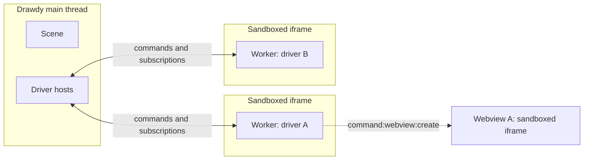

The Drawdy Driver Protocol is the message envelope, the driver module contract, every command and subscription, and the data types they carry. All of it is exported as types from `@drawdy/driver-protocol`. This page covers the envelope, the module, and the manifest.

## Where your driver runs



Drawdy keeps the canvas on the main thread and runs drivers off it. Each driver gets its own **worker thread**, started inside its own sandboxed `iframe`. Your `activate` and `onEvent` execute there. A driver doing real work never blocks a frame, so the canvas stays smooth no matter what an extension is doing. Drawdy and the worker talk only through the protocol envelope: the [commands](/protocol/commands) and [subscriptions](/protocol/subscriptions) in this reference are the entire surface between them.

Drivers are isolated from one another:

- **Separate globals.** Each worker has its own global scope, so a driver cannot read or patch another driver's variables, prototypes, `fetch`, or messages.
- **Separate threads.** A driver stuck in a long loop delays only itself. Other drivers keep running.
- **Identity comes from the channel.** Drawdy knows which driver sent a command by the worker it came from, not by the message's `driverId` field. A command that names another driver's id still runs as the driver that sent it.

### Webviews

A [webview](/protocol/webview-api) is a separate sandboxed `iframe` with an opaque origin. It cannot reach Drawdy's DOM or storage, your driver's worker, or another extension's webview. Use one for custom UI or third-party HTML.

A webview's scripts do not get their own thread:

| Browser          | Where webview scripts run                                                      |
| ---------------- | ------------------------------------------------------------------------------ |
| Chrome           | A process separate from Drawdy, shared by all sandboxed iframes on the page     |
| Firefox, Safari  | Drawdy's main thread                                                            |

So in Firefox and Safari, a webview busy for a second freezes the canvas for a second. Keep heavy work out of the webview's main thread: do it in the driver, or in a worker the webview starts. For rendering, move the canvas to that worker with `canvas.transferControlToOffscreen()` and forward input events to it.

### The trust model

Isolation stops extensions from reading or interfering with each other. It does not limit what a driver does with the [permissions](/protocol/permissions) the user grants it: a driver with `scene` can edit the board, whatever its intent. **Every driver is reviewed before it can be published**, and the user installs extensions from sources they trust. Review and permissions decide what a driver may do; isolation keeps one driver's code away from another's.

## The envelope

Every message — command or subscription — is a `ProtocolCommand`:

```ts
type ProtocolCommand<T, REQ, RES> = {
    driverId: string;
    requestId: string;
    type: T;
    res:
        | { error?: never; value: RES }
        | { error: ProtocolCommandError; value?: never };
} & (REQ extends undefined ? {} : { req: REQ });
```

- **`type`** identifies the command, e.g. `"command:camera:get-info"`.
- **`driverId`** is your extension's id (from the manifest).
- **`requestId`** is any value unique within your driver; it pairs a response to its request.
- **`req`** carries the request payload. Commands with no input omit it.
- **`res`** is the response: either `{ value }` or `{ error }`. On failure `error` is a structured [`ProtocolCommandError`](#errors)

## Errors

A failed command carries a `ProtocolCommandError` in `res.error` — a discriminated `type` you can branch on, plus an optional human-readable `message` and a `body` with structured detail. The `type` values mirror familiar HTTP semantics:

```ts
interface ProtocolError<T extends string> {
    type: T;
    message?: string;
    body?: Record<string, any>;
}

type ProtocolCommandError =
    | ProtocolError<"runtime"> // an unexpected drawdy-side failure (HTTP 500)
    | ProtocolError<"bad-argument"> // the request was malformed (HTTP 400)
    | ProtocolError<"not-found"> // a referenced element/resource is missing (HTTP 404)
    | ProtocolError<"unauthorized">; // permission was not granted, or the board is view-only (HTTP 401)
```

Branch on `error.type` to react (e.g. degrade gracefully on `"unauthorized"`, which means the command's [permission](/protocol/permissions) was not granted, or, with `body.reason: "read-only"`, that the board is view-only for this user; see [View-only boards](/protocol/commands#view-only-boards)); read `error.message` for display and `error.body` for the specifics (`not-found` carries the missing id, for instance).

You never build the whole object with `res` yourself. You issue a **request** — the command minus `res` — and receive a **response** — the command minus `req`:

```ts
type DriverCommandRequest = DistributiveOmit<DriverCommand, "res">;
type DriverCommandResponse = DistributiveOmit<DriverCommand, "req">;
```

Read a result off `response.res`:

```ts
const response = await issueCommand({
    type: "command:camera:get-info",
    driverId,
    requestId: nextRequestId(),
});

if (response.res.error) {
    // handle failure
} else {
    const { x, y, zoom } = response.res.value;
}
```

Three guarantees hold across the envelope: **every request resolves** (with a value or an error), **requests are processed in the order Drawdy receives them**, and **each command is explicit** — it does exactly one thing, with no overloaded calls or hidden side effects.

## The driver module

A driver exports a `DriverModule`:

```ts
type DriverModule = {
    activate(args: {
        issueCommand: DriverCommandIssuer;
        manifest: DriverManifest;
        styling: ModuleStyling;
        generateId: () => string;
    }): Promise<void>;

    onEvent(e: DriverSubscriptionEvent): Promise<void>;
};

type DriverCommandIssuer = <R extends DriverCommandRequest>(
    r: R
) => Promise<DriverCommandResponseFor<R>>;
```

- **`activate`** runs once when Drawdy loads the driver. Use it to register menus, panels, and subscriptions, and to issue any startup commands.
    - **`issueCommand`** sends a command and resolves to its typed response.
    - **`manifest`** is the registered [manifest](#manifest).
    - **`styling`** is the current theme — see [`ModuleStyling`](/protocol/data-types#modulestyling).
    - **`generateId`** mints ids for canvas elements you create.
- **`onEvent`** receives every [subscription event](/protocol/subscriptions) your driver is registered for.

## Manifest

```ts
interface DriverManifest {
    driverId: string;
    driverName: string;
    driverVersion: string;
    description?: string;
    main: string;
    permissions: ProtocolPermission[];
}
```

`main` is the entry bundle filename inside the `.drawdyx` zip. `permissions` lists every [permission](/protocol/permissions) the driver may need; commands that need an undeclared one fail with `unauthorized`.

## In this section

- **[Permissions](/protocol/permissions)** — what each permission grants, how to declare them, and when the user is asked.
- **[Commands](/protocol/commands)** — every command a driver can issue, with its request and response.
- **[Subscriptions](/protocol/subscriptions)** — the events Drawdy pushes to `onEvent`.
- **[Webview API](/protocol/webview-api)** — the `acquireDrawdyApi()` global inside a webview document.
- **[Data Types](/protocol/data-types)** — elements, schemas, styling, tool state, and CSS units.
